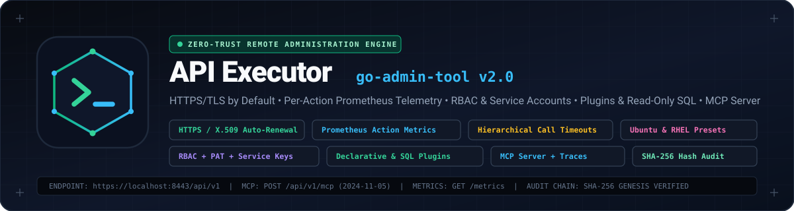
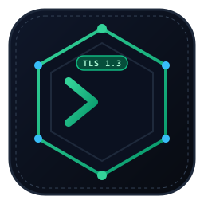

<p align="center">
  
</p>

<p align="center">
  
</p>

<h1 align="center">API Executor (<code>go-admin-tool</code> v2.0)</h1>

<p align="center">
  <strong>Zero-Trust Remote Command Executor, Container-Testable Ubuntu &amp; RedHat OS Task Presets, RBAC &amp; Service Accounts, Extensible Declarative/Native Plugins, Read-Only SQL Explorer, Model Context Protocol (MCP) Server with Trace Retention, and SHA-256 Tamper-Evident Audit Logging.</strong>
</p>

<p align="center">
  <a href="docs/SECURITY_AND_ARCHITECTURE_ANALYSIS.md"></a>
  <a href="internal/api/router.go"></a>
  <a href="internal/mcp/server.go"></a>
  <a href="docs/ACTION_LOGBOOK.md"></a>
</p>

---

## Overview

**API Executor (`go-admin-tool`)** is a self-contained, zero-trust Go administration platform designed for secure remote command execution, operating system inspection, database observability, and AI agent tool orchestration.

### Key Capabilities

1. **HTTPS / TLS 1.3 Enabled by Default (`internal/core/tls.go`)**:
   - Automatic X.509 ECDSA P-256 self-signed certificate provisioning (`certs/server.crt`, `certs/server.key` with `0600` key permissions) when no external PKI certificate is supplied.
   - Zero-downtime certificate rotation (`POST /api/v1/tls/renew`) via atomic `sync.RWMutex` `GetCertificate` callbacks, optional mTLS client CA validation, and `Strict-Transport-Security` (HSTS) headers.
2. **Hierarchical Call Timeout System (`internal/core/executor.go`)**:
   - Deterministic 4-level timeout resolution: **Per-Call API Override (`"timeout": "5s"`) > Per-Command YAML Timeout > Global `executor.default_timeout` > Built-In `30s` Fallback** (`DefaultCommandTimeout`).
   - Process-group termination (`Setpgid` + negative-PID `SIGKILL` on Linux/macOS; `WaitDelay` on Windows/Unix) prevents orphan grandchild processes from hanging stdout/stderr pipes after timeout expiration.
3. **Enriched Per-Action Prometheus Metrics (`internal/api/router.go`)**:
   - Tracks total calls (`action_calls_total`), successful calls (`action_calls_ok_total`), invalid/system error calls (`action_calls_error_total`), failed/non-zero/timed-out calls (`action_calls_failure_total`), timeout count (`action_calls_timeout_total`), partitioned status vector (`action_calls_status_total{action,status}`), and latency histogram (`action_call_duration_seconds`).
   - Protects against label cardinality DoS via `MaxDynamicActionLabels = 64`.
4. **Predefined Ubuntu & RedHat / RHEL OS Tasks (`internal/core/os_presets.go`)**:
   - Ready-to-run, container-safe system administration catalogs for **Ubuntu / Debian** (`configs/ubuntu-tasks.yaml`, `docker/Dockerfile.ubuntu`) and **RedHat / RHEL / UBI9** (`configs/redhat-tasks.yaml`, `docker/Dockerfile.redhat`), orchestrated via `docker-compose.os-test.yml` and dynamically activatable at runtime (`POST /api/v1/presets/activate`).
5. **Pure Web Administration Console (`web/static/index.html`)**:
   - Single-page 8-tab dark enterprise console covering Command Execution, Ubuntu & RedHat Presets, RBAC Users & Personal Access Tokens, Third-Party Service Accounts, Extensible Plugins & Read-Only SQL Explorer, Interactive MCP Playground & Trace Inspector, SHA-256 Audit Trail, and X.509 TLS Certificate Management.
6. **RBAC User Management, Personal Access Tokens & Third-Party Service Accounts (`internal/auth/manager.go`)**:
   - Role-Based Access Control (`admin`, `operator`, `viewer`), Personal Access Tokens (`gat_pat_...`) for remote CLI/API calls, and machine-to-machine Third-Party Service Accounts (`gat_svc_...`) with wildcard action scoping (`allowed_actions`: e.g. `disk-usage`, `ubuntu-*`, `db-exposure`) and instant key rotation.
7. **Extensible Plugin System & Guarded Read-Only Database Exposure (`internal/plugins/`)**:
   - **Declarative Command Plugins**: Register YAML/JSON command modules (`plugins/network-audit.yaml` or via `POST /api/v1/plugins/declarative`) with strict regex parameter validation (`^[a-zA-Z0-9._:/-]+$`) and direct `exec.CommandContext` argv execution (zero shell interpolation).
   - **Native `db-exposure` Plugin**: Exposes read-only SQLite inspection (`GET /api/v1/db/tables`) and parameterized `SELECT` queries (`POST /api/v1/db/query`) guarded by `ValidateReadOnlySQL` (blocks `INSERT`, `UPDATE`, `DELETE`, `DROP`, `ALTER`, `PRAGMA`, `ATTACH`, comments, and multi-statement semicolons) with automatic `LIMIT` bounding.
   - **Native `sys-diagnostics` Plugin**: Provides cross-platform Go runtime, memory, and environment telemetry.
8. **Model Context Protocol (MCP) Server with Persistent Trace Retention (`internal/mcp/server.go`)**:
   - Full JSON-RPC 2.0 MCP (`2024-11-05`) server (`POST /api/v1/mcp`) supporting `initialize`, `ping`, `tools/list`, `tools/call`, `resources/list`, `resources/read`, `prompts/list`, and `prompts/get`.
   - Every MCP interaction generates an immutable `TraceRecord` (`mcp_tr_<hex>`) persisted to SQLite/JSONL and cross-referenced with the SHA-256 audit log (`GET /api/v1/mcp/traces`).
9. **Tamper-Evident SHA-256 Hash-Chained Audit Trail & Structured Logging (`internal/audit/audit.go`, `internal/core/logger.go`)**:
   - Every command execution, auth event, plugin call, TLS rotation, and MCP invocation is chained cryptographically (`prev_hash` -> `entry_hash` starting from `GENESIS`) and verifiable on demand via `GET /api/v1/audit/verify`.

---

## Architecture & Repository Layout

```text
.
├── AGENTS.md                                    # Mandatory engineering & atomic GitHub workflow rules
├── .agents/rules/                               # Enforceable rules (atomic-workflow, english-only, governance)
├── cmd/server/main.go                           # Main HTTPS/HTTP server entrypoint & subsystem wiring
├── config.yaml                                  # Default server, TLS, timeout, auth, plugin, MCP & audit config
├── configs/
│   ├── ubuntu-tasks.yaml                        # Predefined Ubuntu / Debian administration task preset config
│   └── redhat-tasks.yaml                        # Predefined RedHat / RHEL / Rocky / AlmaLinux preset config
├── docker/
│   ├── Dockerfile.ubuntu                        # Ubuntu 22.04 container image for OS preset integration testing
│   └── Dockerfile.redhat                        # RedHat UBI9 container image for OS preset integration testing
├── docker-compose.os-test.yml                   # Multi-container Ubuntu + RedHat test topology
├── docs/
│   ├── assets/
│   │   ├── logo.svg                             # Custom vector shield & terminal emblem
│   │   └── header-banner.svg                    # Custom panoramic SVG hero banner
│   ├── ACTION_LOGBOOK.md                        # Living register of ongoing and completed atomic actions
│   ├── RCA_REGISTER.md                          # Root Cause Analysis, dead-ends, approximations & roadmap register
│   └── SECURITY_AND_ARCHITECTURE_ANALYSIS.md    # Comprehensive security & architectural analysis
├── internal/
│   ├── api/                                     # REST handlers, Prometheus metrics, auth/plugin/MCP/TLS routes
│   ├── audit/                                   # SHA-256 hash-chained tamper-evident audit logger
│   ├── auth/                                    # RBAC users, Personal Access Tokens & Service Accounts
│   ├── core/                                    # Config loader, timeout hierarchy, OS presets, TLS manager, logger
│   ├── database/                                # SQLite persistence with pure-Go in-memory fallback (CGO_ENABLED=0)
│   ├── mcp/                                     # JSON-RPC 2.0 Model Context Protocol server & trace store
│   └── plugins/                                 # Plugin registry, declarative runner, db-exposure & sys-diagnostics
├── plugins/
│   └── network-audit.yaml                       # Declarative YAML plugin manifest example
└── web/static/
    └── index.html                               # 8-tab Pure Web Administration Console
```

---

## Quick Start

### 1. Build and Run Locally (HTTPS Enabled by Default)

```bash
# Run all unit and integration tests with coverage
go test -v -cover ./...

# Build the server binary
go build -o bin/go-admin-tool ./cmd/server

# Start the server (auto-generates ECDSA P-256 TLS certificate in ./certs if missing)
./bin/go-admin-tool
```

Open **`https://localhost:8080`** in your browser to access the **Web Administration Console**, **`https://localhost:8080/metrics`** for Prometheus telemetry, or **`https://localhost:8080/swagger/index.html`** for OpenAPI documentation.

### 2. Test Predefined Ubuntu & RedHat OS Tasks via Docker

```bash
# Build and launch both Ubuntu 22.04 (:8443) and RedHat UBI9 (:8444) targets
docker compose -f docker-compose.os-test.yml up --build -d

# Query active Ubuntu presets
curl -k https://localhost:8443/api/v1/commands

# Execute a predefined RedHat package audit with a 10-second per-call timeout override
curl -k -X POST https://localhost:8444/api/v1/execute \
  -H "Content-Type: application/json" \
  -d '{"name": "redhat-rpm-packages", "timeout": "10s"}'
```

---

## Feature Deep Dive & API Examples

### 1. Hierarchical Call Timeouts & Per-Action Prometheus Metrics

Every command execution resolves its effective timeout through a 4-tier hierarchy:
1. **Per-Call Request Parameter** (`"timeout"` in `POST /api/v1/execute` body or `?timeout=` query parameter — accepts Go duration strings like `"5s"`, `"500ms"` or numeric seconds like `"15"`).
2. **Per-Command Configuration** (`executor.commands[].timeout` in `config.yaml`).
3. **Global Executor Default** (`executor.default_timeout` in `config.yaml`).
4. **System Fallback** (`30s` `DefaultCommandTimeout`).

```bash
curl -k -X POST https://localhost:8080/api/v1/execute \
  -H "Content-Type: application/json" \
  -d '{"name": "list-processes", "timeout": "5s"}'
```

Prometheus `/metrics` exposes per-action counters and histograms:

| Metric Name | Type | Labels | Description |
|---|---|---|---|
| `action_calls_total` | Counter | `action` | Total number of calls per action |
| `action_calls_ok_total` | Counter | `action` | Total number of successful (`exit 0`) calls per action |
| `action_calls_error_total` | Counter | `action` | Total number of calls in error (invalid parameters, unknown action, or spawn error) |
| `action_calls_failure_total` | Counter | `action` | Total number of failed calls (non-zero exit status or timeout) |
| `action_calls_timeout_total` | Counter | `action` | Total number of timed-out calls per action |
| `action_calls_status_total` | Counter | `action`, `status` | Calls partitioned by `status="ok"\|"error"\|"failure"` |
| `action_call_duration_seconds` | Histogram | `action` | Execution latency distribution per action |

---

### 2. RBAC Users, Personal Access Tokens (`gat_pat_...`) & Service Accounts (`gat_svc_...`)

#### Issue a Personal Access Token (PAT) for Remote API Calls

```bash
curl -k -X POST https://localhost:8080/api/v1/auth/tokens \
  -H "Content-Type: application/json" \
  -d '{"user_id": "admin", "name": "ansible-remote-cli", "ttl": "720h"}'
```

Use the returned `gat_pat_...` token via `Authorization: Bearer <token>` or `X-API-Token: <token>`:

```bash
curl -k -X POST https://localhost:8080/api/v1/execute \
  -H "X-API-Token: gat_pat_<your_token>" \
  -H "Content-Type: application/json" \
  -d '{"name": "disk-usage"}'
```

#### Provision a Third-Party Service Account Restricted to Specific Actions

```bash
curl -k -X POST https://localhost:8080/api/v1/auth/service-accounts \
  -H "Content-Type: application/json" \
  -d '{
    "name": "datadog-probe",
    "service_name": "Datadog Agent",
    "description": "Read-only Ubuntu diagnostics and SQL history inspection",
    "allowed_actions": ["ubuntu-*", "db-exposure", "plugin:db-exposure:*"],
    "ttl": "2160h"
  }'
```

Authenticate third-party service calls with `X-Service-Key: gat_svc_<key>`.

---

### 3. Extensible Plugin System & Guarded Read-Only Database Exposure

#### Execute a Declarative or Native Plugin Action

```bash
curl -k -X POST https://localhost:8080/api/v1/plugins/execute \
  -H "Content-Type: application/json" \
  -d '{
    "plugin_id": "sys-diagnostics",
    "action": "runtime-stats",
    "params": {}
  }'
```

#### Query the SQLite Database Safely via `db-exposure`

```bash
# List tables, column schemas, and row counts
curl -k https://localhost:8080/api/v1/db/tables

# Run a guarded read-only SELECT query (DDL/DML/PRAGMA/multi-statement rejected)
curl -k -X POST https://localhost:8080/api/v1/db/query \
  -H "Content-Type: application/json" \
  -d '{
    "sql": "SELECT id, timestamp, command, status FROM action_history ORDER BY id DESC LIMIT 10",
    "max_rows": 10
  }'
```

---

### 4. Model Context Protocol (MCP) Server & Persistent Trace Retention

AI agents and MCP hosts can interact with `POST /api/v1/mcp` using standard JSON-RPC 2.0 (`protocolVersion: "2024-11-05"`):

```bash
# List all MCP tools (commands, OS presets, plugins, SQL query, audit verification, TLS status)
curl -k -X POST https://localhost:8080/api/v1/mcp \
  -H "Content-Type: application/json" \
  -H "X-MCP-Session-ID: claude-desktop-01" \
  -d '{"jsonrpc": "2.0", "id": 1, "method": "tools/list", "params": {}}'

# Invoke a tool via MCP and automatically record a trace + SHA-256 audit event
curl -k -X POST https://localhost:8080/api/v1/mcp \
  -H "Content-Type: application/json" \
  -H "X-MCP-Session-ID: claude-desktop-01" \
  -d '{
    "jsonrpc": "2.0",
    "id": 2,
    "method": "tools/call",
    "params": {
      "name": "audit_verify",
      "arguments": {}
    }
  }'

# Inspect retained MCP execution traces (mcp_tr_<hex>)
curl -k "https://localhost:8080/api/v1/mcp/traces?limit=20"
```

---

## Complete REST API Summary

| Method | Endpoint | Description |
|---|---|---|
| `GET` | `/` | Pure 8-tab Web Administration Console (`web/static/index.html`) |
| `GET` | `/api/v1/commands` | List active commands with OS family and default timeout metadata |
| `POST` | `/api/v1/execute` | Execute a predefined command with optional per-call `timeout` override |
| `GET` | `/api/v1/presets` | List predefined Ubuntu and RedHat OS task catalogs |
| `POST` | `/api/v1/presets/activate` | Dynamically merge Ubuntu and/or RedHat presets into active commands |
| `POST` | `/api/v1/auth/login` | Authenticate user credentials and issue a Personal Access Token |
| `GET` | `/api/v1/auth/me` | Inspect the currently authenticated principal (`user`, `service_account`, or `anonymous`) |
| `GET/POST/PATCH/DELETE` | `/api/v1/auth/users` | Manage RBAC user accounts (`admin`, `operator`, `viewer`) |
| `GET/POST/DELETE` | `/api/v1/auth/tokens` | Issue, list, and revoke Personal Access Tokens (`gat_pat_...`) |
| `GET/POST/DELETE` | `/api/v1/auth/service-accounts` | Register, list, and delete Third-Party Service Accounts (`gat_svc_...`) |
| `POST` | `/api/v1/auth/service-accounts/rotate` | Rotate a Service Account API key with zero downtime |
| `GET` | `/api/v1/plugins` | List registered declarative and native plugins |
| `POST` | `/api/v1/plugins/execute` | Execute a plugin action with validated parameters |
| `POST` | `/api/v1/plugins/declarative` | Dynamically register a declarative command plugin manifest |
| `GET` | `/api/v1/db/tables` | Inspect SQLite tables and column schemas via `db-exposure` |
| `POST` | `/api/v1/db/query` | Execute a guarded read-only `SELECT` query |
| `POST` | `/api/v1/mcp` | Model Context Protocol (MCP) JSON-RPC 2.0 endpoint |
| `GET` | `/api/v1/mcp/tools` | Inspect exposed MCP tools, resources, and prompt templates |
| `GET` | `/api/v1/mcp/traces` | Query retained MCP interaction traces (`mcp_tr_<hex>`) |
| `GET` | `/api/v1/audit/logs` | Query tamper-evident SHA-256 hash-chained audit events |
| `GET` | `/api/v1/audit/verify` | Cryptographically verify the entire SHA-256 audit hash chain |
| `GET` | `/api/v1/logs` | Query structured application logs from the in-memory ring buffer |
| `GET` | `/api/v1/history` | Query historical command executions from SQLite |
| `GET` | `/api/v1/tls/info` | Inspect active X.509 certificate metadata and SHA-256 fingerprint |
| `GET` | `/api/v1/tls/certificate` | Download the public PEM server certificate |
| `POST` | `/api/v1/tls/renew` | Force immediate zero-downtime X.509 certificate rotation |
| `GET` | `/api/v1/files` | List files in the configured secure download directory |
| `GET` | `/api/v1/files/{filename}` | Download a file with path-traversal protection |
| `GET` | `/metrics` | Prometheus metrics scrape endpoint |
| `GET` | `/swagger/index.html` | Interactive Swagger / OpenAPI documentation |

---

## Project Governance & Living Registers

This repository enforces strict atomic engineering governance defined in [`AGENTS.md`](AGENTS.md):
- **Strict Atomic Workflow** ([`.agents/rules/atomic-workflow.md`](.agents/rules/atomic-workflow.md)): **1 Item = 1 Issue = 1 Branch = 1 Pull Request = 1 Merge**.
- **English-Only Policy** ([`.agents/rules/english-only.md`](.agents/rules/english-only.md)): All code, tests, UI labels, documentation, and governance registers are maintained exclusively in English.
- **Action Logbook** ([`docs/ACTION_LOGBOOK.md`](docs/ACTION_LOGBOOK.md)): Tracks every ongoing and completed engineering action with verification metrics and PR references.
- **RCA & Technical Transparency Register** ([`docs/RCA_REGISTER.md`](docs/RCA_REGISTER.md)): Records all root cause analyses (`RCA-XXX`), abandoned dead-ends (`IMP-XXX`), current approximations (`APP-XXX`), and future roadmap items (`IDEA-XXX`).
- **Security & Architecture Analysis** ([`docs/SECURITY_AND_ARCHITECTURE_ANALYSIS.md`](docs/SECURITY_AND_ARCHITECTURE_ANALYSIS.md)): Documents threat mitigations, OS presets, and subsystem architecture.

## License

Released under the [MIT License](LICENSE).
