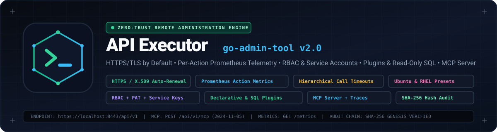
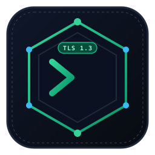

<p align="center">
  
</p>

<p align="center">
  
</p>

<h1 align="center">API Executor (<code>go-admin-tool</code> v2.0)</h1>

<p align="center">
  <strong>Zero-Trust Remote Command Executor, Container-Testable Ubuntu &amp; RedHat OS Task Presets, RBAC &amp; Service Accounts, Extensible Declarative/Native Plugins, Read-Only SQL Explorer, Model Context Protocol (MCP) Server with Trace Retention, and SHA-256 Tamper-Evident Audit Logging.</strong>
</p>

[](https://github.com/jmrenouard/api_executor/releases/latest)
[](https://hub.docker.com/r/jmrenouard/api_executor)
[](docs/SECURITY_AND_ARCHITECTURE_ANALYSIS.md)
[](internal/api/router.go)
[](internal/mcp/server.go)
[](docs/ACTION_LOGBOOK.md)


---

## Overview

**API Executor (`go-admin-tool`)** is a self-contained, zero-trust Go administration platform designed for secure remote command execution, operating system inspection, database observability, and AI agent tool orchestration.

### Key Capabilities

1. **HTTPS / TLS 1.3 Enabled by Default (`internal/core/tls.go`)**:
   - Automatic X.509 ECDSA P-256 self-signed certificate provisioning (`certs/server.crt`, `certs/server.key` with `0600` key permissions) when no external PKI certificate is supplied.
   - Zero-downtime certificate rotation (`POST /api/v1/tls/renew`) via atomic `sync.RWMutex` `GetCertificate` callbacks, optional mTLS client CA validation, and `Strict-Transport-Security` (HSTS) headers.
2. **Hierarchical Call Timeout System (`internal/core/executor.go`)**:
   - Deterministic 4-level timeout resolution: **Per-Call API Override (`"timeout": "5s"`) > Per-Command YAML Timeout > Global `executor.default_timeout` > Built-In `30s` Fallback** (`DefaultCommandTimeout`).
   - Process-group termination (`Setpgid` + negative-PID `SIGKILL` on Linux/macOS; `WaitDelay` on Windows/Unix) prevents orphan grandchild processes from hanging stdout/stderr pipes after timeout expiration.
3. **Enriched Per-Action Prometheus Metrics (`internal/api/router.go`)**:
   - Tracks total calls (`action_calls_total`), successful calls (`action_calls_ok_total`), invalid/system error calls (`action_calls_error_total`), failed/non-zero/timed-out calls (`action_calls_failure_total`), timeout count (`action_calls_timeout_total`), partitioned status vector (`action_calls_status_total{action,status}`), and latency histogram (`action_call_duration_seconds`).
   - Protects against label cardinality DoS via `MaxDynamicActionLabels = 64`.
4. **Predefined Ubuntu & RedHat / RHEL OS Tasks (`internal/core/os_presets.go`)**:
   - Ready-to-run, container-safe system administration catalogs for **Ubuntu / Debian** (`configs/ubuntu-tasks.yaml`, `docker/Dockerfile.ubuntu`) and **RedHat / RHEL / UBI9** (`configs/redhat-tasks.yaml`, `docker/Dockerfile.redhat`), orchestrated via `docker-compose.os-test.yml` and dynamically activatable at runtime (`POST /api/v1/presets/activate`).
5. **Pure Web Administration Console (`web/static/index.html`)**:
   - Single-page 9-tab dark enterprise console covering Command Execution, Ubuntu & RedHat Presets, RBAC Users & Personal Access Tokens, Third-Party Service Accounts, Extensible 300+ Plugins Catalog & Read-Only SQL Explorer, Interactive MCP Playground & Trace Inspector, SHA-256 Audit Trail, X.509 TLS Certificate Management, and Asynchronous Action Execution & Job Queue Management (Tab 9).
   - **Tab 5 Master-Detail Catalog**: Instant client-side search, 10 domain category pills with live count badges, type filter toggles (`All`, `Native`, `Declarative`), client-side pagination, dynamic parameter form generation with typed controls (boolean toggles, numeric inputs, regex pattern hints), two-way JSON mode synchronization, and formatted execution telemetry.
6. **RBAC User Management, Personal Access Tokens & Third-Party Service Accounts (`internal/auth/manager.go`)**:
   - Role-Based Access Control (`admin`, `operator`, `viewer`), Personal Access Tokens (`gat_pat_...`) for remote CLI/API calls, and machine-to-machine Third-Party Service Accounts (`gat_svc_...`) with wildcard action scoping (`allowed_actions`: e.g. `disk-usage`, `ubuntu-*`, `db-exposure`, `plugin:sys-diagnostics:*`) and instant key rotation.
7. **300+ Plugins Enterprise Ecosystem & Guarded Read-Only Database Exposure (`internal/plugins/`)**:
   - **305 Production-Ready Plugins Across 10 Domains**: 24 pure-Go native plugins (zero CGO) + 281 declarative YAML plugins spanning `SysAdmin`, `NetOps`, `SecOps`, `ContainerOps`, `Kubernetes`, `DataOps`, `DevOps`, `SRE`, `AIOps`, and `WebUtils`.
   - **Recursive Directory Discovery**: Automatic discovery via `filepath.WalkDir` traversing `plugins/<domain>/` subdirectories with domain fallback categorization.
   - **Multi-Attribute Query Filtering**: `GET /api/v1/plugins` supports case-insensitive `?category=...`, keyword search `?q=...`, and `?type=native|declarative`.
   - **Guarded Direct Subprocess Execution**: Strict parameter type validation, regex pattern enforcement (`^[a-zA-Z0-9._:/-]+$`), path-traversal prevention, and direct `exec.CommandContext` argv execution (zero shell interpolation).
   - **Native `db-exposure` Plugin**: Exposes read-only SQLite inspection (`GET /api/v1/db/tables`) and parameterized `SELECT` queries (`POST /api/v1/db/query`) guarded by `ValidateReadOnlySQL` (blocks `INSERT`, `UPDATE`, `DELETE`, `DROP`, `ALTER`, `PRAGMA`, `ATTACH`, comments, and multi-statement semicolons) with automatic `LIMIT` bounding.
8. **Model Context Protocol (MCP) Server & Meta-Tool Pattern (`internal/mcp/server.go`)**:
   - Full JSON-RPC 2.0 MCP (`2024-11-05`) server (`POST /api/v1/mcp`) supporting `initialize`, `ping`, `tools/list`, `tools/call`, `resources/list`, `resources/read`, `prompts/list`, and `prompts/get`.
   - **Meta-Tool Pattern**: Exposes the complete 300+ plugins catalog as a structured MCP resource (`executor://plugins/catalog`) and provides the `execute_plugin` meta-tool, giving LLMs access to all 300+ plugins without overflowing token context windows.
   - Every MCP interaction generates an immutable `TraceRecord` (`mcp_tr_<hex>`) persisted to SQLite/JSONL and cross-referenced with the SHA-256 audit log (`GET /api/v1/mcp/traces`).
9. **Tamper-Evident SHA-256 Hash-Chained Audit Trail & Structured Logging (`internal/audit/audit.go`, `internal/core/logger.go`)**:
   - Every command execution, auth event, plugin call, TLS rotation, and MCP invocation is chained cryptographically (`prev_hash` -> `entry_hash` starting from `GENESIS`) and verifiable on demand via `GET /api/v1/audit/verify`.
10. **Asynchronous Action Execution Engine & Priority Job Queue (`internal/jobs/`)**:
    - **Non-Blocking Dispatch**: Decouples long-running system commands and plugin operations from synchronous HTTP request threads via `POST /api/v1/jobs`, returning `202 Accepted` with deterministic poll (`/api/v1/jobs/{id}`) and live log tailing (`/api/v1/jobs/{id}/logs`) URLs.
    - **3-Tier Priority Heap Queue (`container/heap`)**: Jobs are prioritized across `High`, `Normal`, and `Low` tiers with monotonic sequence tie-breaking (FIFO within tiers) and bounded backpressure (`429 Too Many Requests` when queue capacity of 1,000 jobs is reached).
    - **Graceful Worker Pool**: Bounded concurrent worker goroutines with graceful drain on server shutdown.
    - **Concurrency-Safe Live Log Streaming**: In-memory ring buffer (`JobLogBuffer`) capturing stdout/stderr in real time up to `2 MiB` per job with chunked offset retrieval (`?offset=X`), truncation flags, and EOF detection.
    - **Immediate Subprocess Group Termination**: `POST /api/v1/jobs/{id}/cancel` instantly terminates running process groups (`taskkill /T /F` on Windows; negative-PID `SIGKILL` on Unix).
    - **Tamper-Evident SHA-256 Chaining**: Every job lifecycle transition (`job.enqueued`, `job.started`, `job.completed`, `job.failed`, `job.cancelled`) records a SHA-256 audit event verified via `/api/v1/audit/verify`.
    - **Web Administration Console Tab 9**: Real-time queue telemetry (queued jobs, active workers, queue capacity), interactive submission form (commands or plugins), filtered execution history table, and live streaming log viewer modal with auto-refresh.

---

## Architecture & Repository Layout

```text
.
├── AGENTS.md                                    # Mandatory engineering & atomic GitHub workflow rules
├── .agents/rules/                               # Enforceable rules (atomic-workflow, english-only, governance)
├── cmd/server/main.go                           # Main HTTPS/HTTP server entrypoint & subsystem wiring
├── config.yaml                                  # Default server, TLS, timeout, auth, plugin, MCP & audit config
├── configs/
│   ├── ubuntu-tasks.yaml                        # Predefined Ubuntu / Debian administration task preset config
│   └── redhat-tasks.yaml                        # Predefined RedHat / RHEL / Rocky / AlmaLinux preset config
├── docker/
│   ├── Dockerfile.ubuntu                        # Ubuntu 22.04 container image for OS preset integration testing
│   └── Dockerfile.redhat                        # RedHat UBI9 container image for OS preset integration testing
├── docker-compose.os-test.yml                   # Multi-container Ubuntu + RedHat test topology
├── docs/
│   ├── assets/
│   │   ├── logo.svg                             # Custom vector shield & terminal emblem
│   │   └── header-banner.svg                    # Custom panoramic SVG hero banner
│   ├── ACTION_LOGBOOK.md                        # Living register of ongoing and completed atomic actions
│   ├── RCA_REGISTER.md                          # Root Cause Analysis, dead-ends, approximations & roadmap register
│   └── SECURITY_AND_ARCHITECTURE_ANALYSIS.md    # Comprehensive security & architectural analysis
├── internal/
│   ├── api/                                     # REST handlers, Prometheus metrics, auth/plugin/MCP/TLS routes
│   ├── audit/                                   # SHA-256 hash-chained tamper-evident audit logger
│   ├── auth/                                    # RBAC users, Personal Access Tokens & Service Accounts
│   ├── core/                                    # Config loader, timeout hierarchy, OS presets, TLS manager, logger
│   ├── database/                                # SQLite persistence with pure-Go in-memory fallback (CGO_ENABLED=0)
│   ├── jobs/                                    # Priority queue, worker pool, log buffer & persistent SQLite store
│   ├── mcp/                                     # JSON-RPC 2.0 Model Context Protocol server & trace store
│   └── plugins/                                 # Plugin registry, declarative runner, db-exposure & sys-diagnostics
├── plugins/                                     # 280 declarative YAML plugin manifests across 10 operational domains
│   ├── sysadmin/                                # System, CPU, memory, storage & kernel inspection (28 plugins)
│   ├── netops/                                  # Interfaces, routing, DNS, firewall & connectivity (28 plugins)
│   ├── secops/                                  # Audit logs, sudo, SUID, permissions & compliance (28 plugins)
│   ├── containerops/                            # Docker, containerd, crictl & Podman lifecycle (28 plugins)
│   ├── kubernetes/                              # Nodes, pods, services, ingress & Helm releases (28 plugins)
│   ├── dataops/                                 # SQLite, PostgreSQL, MySQL, Redis, MongoDB & backups (28 plugins)
│   ├── devops/                                  # Git, compilers, linters, packages & CI runners (28 plugins)
│   ├── sre/                                     # Prometheus, Loki, OpenTelemetry, SLO & FinOps (28 plugins)
│   ├── aiops/                                   # NVIDIA GPU, CUDA, Ollama, vLLM, TGI, MCP & vectors (28 plugins)
│   ├── webutils/                                # HTTP, TLS, X.509, JWT, base64 & archives (28 plugins)
│   └── ops.yaml                                 # Quick operations declarative module
└── web/static/
    └── index.html                               # Pure Web Administration Console (Tab 5 Master-Detail Catalog)
```

---

## Quick Start

### 1. Build and Run Locally (HTTPS Enabled by Default)

```bash
# Run all unit and integration tests with coverage
go test -v -cover ./...

# Build the server binary
go build -o bin/go-admin-tool ./cmd/server

# Start the server (auto-generates ECDSA P-256 TLS certificate in ./certs if missing)
./bin/go-admin-tool
```

Open **`https://localhost:8080`** in your browser to access the **Web Administration Console**, **`https://localhost:8080/metrics`** for Prometheus telemetry, or **`https://localhost:8080/swagger/index.html`** for OpenAPI documentation.

### 2. Run Pre-Built Container Image from Docker Hub

```bash
# Pull the latest hardened multi-arch image (linux/amd64, linux/arm64)
docker pull jmrenouard/api_executor:latest

# Run container with HTTPS exposed on port 8080
docker run -d -p 8080:8080 --name api-executor jmrenouard/api_executor:latest
```

### 3. Download Pre-Compiled Standalone Binaries

Download pre-compiled binaries for Linux (amd64, arm64), macOS (arm64), and Windows (amd64) directly from [GitHub Releases](https://github.com/jmrenouard/api_executor/releases/latest), verified with cryptographic `SHA256SUMS.txt`.

### 4. Test Predefined Ubuntu & RedHat OS Tasks via Docker

```bash
# Build and launch both Ubuntu 22.04 (:8443) and RedHat UBI9 (:8444) targets
docker compose -f docker-compose.os-test.yml up --build -d

# Query active Ubuntu presets
curl -k https://localhost:8443/api/v1/commands

# Execute a predefined RedHat package audit with a 10-second per-call timeout override
curl -k -X POST https://localhost:8444/api/v1/execute \
  -H "Content-Type: application/json" \
  -d '{"name": "redhat-rpm-qa", "timeout": "10s"}'
```

---

## Feature Deep Dive & API Examples

### 1. Hierarchical Call Timeouts & Per-Action Prometheus Metrics

Every command execution resolves its effective timeout through a 4-tier hierarchy:
1. **Per-Call Request Parameter** (`"timeout"` in `POST /api/v1/execute` body or `?timeout=` query parameter — accepts Go duration strings like `"5s"`, `"500ms"` or numeric seconds like `"15"`).
2. **Per-Command Configuration** (`executor.commands[].timeout` in `config.yaml`).
3. **Global Executor Default** (`executor.default_timeout` in `config.yaml`).
4. **System Fallback** (`30s` `DefaultCommandTimeout`).

```bash
curl -k -X POST https://localhost:8080/api/v1/execute \
  -H "Content-Type: application/json" \
  -d '{"name": "list-processes", "timeout": "5s"}'
```

Prometheus `/metrics` exposes per-action counters and histograms:

| Metric Name | Type | Labels | Description |
|---|---|---|---|
| `action_calls_total` | Counter | `action` | Total number of calls per action |
| `action_calls_ok_total` | Counter | `action` | Total number of successful (`exit 0`) calls per action |
| `action_calls_error_total` | Counter | `action` | Total number of calls in error (invalid parameters, unknown action, or spawn error) |
| `action_calls_failure_total` | Counter | `action` | Total number of failed calls (non-zero exit status or timeout) |
| `action_calls_timeout_total` | Counter | `action` | Total number of timed-out calls per action |
| `action_calls_status_total` | Counter | `action`, `status` | Calls partitioned by `status="ok"\|"error"\|"failure"` |
| `action_call_duration_seconds` | Histogram | `action` | Execution latency distribution per action |

---

### 2. RBAC Users, Personal Access Tokens (`gat_pat_...`) & Service Accounts (`gat_svc_...`)

#### Issue a Personal Access Token (PAT) for Remote API Calls

```bash
curl -k -X POST https://localhost:8080/api/v1/auth/tokens \
  -H "Content-Type: application/json" \
  -d '{"user_id": "admin", "name": "ansible-remote-cli", "ttl": "720h"}'
```

Use the returned `gat_pat_...` token via `Authorization: Bearer <token>` or `X-API-Token: <token>`:

```bash
curl -k -X POST https://localhost:8080/api/v1/execute \
  -H "X-API-Token: gat_pat_<your_token>" \
  -H "Content-Type: application/json" \
  -d '{"name": "disk-usage"}'
```

#### Provision a Third-Party Service Account Restricted to Specific Actions

```bash
curl -k -X POST https://localhost:8080/api/v1/auth/service-accounts \
  -H "Content-Type: application/json" \
  -d '{
    "name": "datadog-probe",
    "service_name": "Datadog Agent",
    "description": "Read-only Ubuntu diagnostics and SQL history inspection",
    "allowed_actions": ["ubuntu-*", "db-exposure", "plugin:db-exposure:*"],
    "ttl": "2160h"
  }'
```

Authenticate third-party service calls with `X-Service-Key: gat_svc_<key>`.

---

### 3. 300+ Plugins Enterprise Ecosystem & Guarded Database Exposure

The **API Executor** plugin engine (`internal/plugins/`) combines high-performance native Go plugins with declarative YAML command manifests, scaled to over 300 production-ready modules across 10 operational domains:

#### Operational Domains & Plugin Architecture

The catalog contains **305 registered plugins** (24 pure-Go native plugins + 281 declarative YAML manifests):

| Domain | Scope & Description | Native Plugins | Declarative Plugins | Total |
|---|---|---|---|---|
| **SysAdmin** | System health, CPU, memory, mount storage, process trees, and kernel telemetry | `sys-diagnostics`, `host-storage-stats`, `system-load-audit`, `kernel-module-audit` | 28 (`plugins/sysadmin/*.yaml`) + `ops-quick-tools` | 33 |
| **NetOps** | Network interfaces, routing tables, ARP cache, DNS resolution, firewall rules & ping | `dns-resolver-audit`, `network-ping` | 28 (`plugins/netops/*.yaml`) | 30 |
| **SecOps** | Authentication logs, sudoers, SUID/SGID binaries, file permissions & crypto hashes | `file-integrity-checker`, `password-policy-audit` | 28 (`plugins/secops/*.yaml`) | 30 |
| **ContainerOps** | Docker, containerd, crictl, and Podman containers, dangling images & networks | `container-runtime-probe`, `container-image-analyzer` | 28 (`plugins/containerops/*.yaml`) | 30 |
| **Kubernetes** | K8s nodes, pods, services, ingress, PVCs, events, and Helm release management | `helm-chart-inspector`, `k8s-resource-quota` | 28 (`plugins/kubernetes/*.yaml`) | 30 |
| **DataOps** | SQLite, PostgreSQL, MySQL, Redis, MongoDB, Elasticsearch, and backup verification | `db-exposure`, `sqlite-analyzer`, `redis-info-probe` | 28 (`plugins/dataops/*.yaml`) | 31 |
| **DevOps** | Git repository status, commits, tags, Go/Node/Python/Rust compilers & linters | `git-repo-inspector`, `semver-validator` | 28 (`plugins/devops/*.yaml`) | 30 |
| **SRE** | Prometheus scraping, Loki log metrics, OpenTelemetry collector, SLO & FinOps | `prometheus-scrape-audit`, `slo-calculator` | 28 (`plugins/sre/*.yaml`) | 30 |
| **AIOps** | NVIDIA GPU/CUDA, Ollama, vLLM, TGI, MCP client, vector databases & datasets | `llm-token-estimator`, `mcp-schema-validator` | 28 (`plugins/aiops/*.yaml`) | 30 |
| **WebUtils** | HTTP latency, headers, SSL/TLS, X.509 certs, JWT headers, base64, JSON & archives | `tls-handshake-probe`, `jwt-inspector` | 28 (`plugins/webutils/*.yaml`) | 30 |

#### Recursive Discovery & Domain Directory Structure

The declarative plugin loader automatically discovers plugin manifests recursively across domain subdirectories using `filepath.WalkDir`:
```text
plugins/
├── sysadmin/      # 28 YAML manifests (sys-cpu-info, sys-memory-free, sys-uptime, ...)
├── netops/        # 28 YAML manifests (net-interfaces, net-routes, net-dns-lookup, ...)
├── secops/        # 28 YAML manifests (sec-auth-failures, sec-sudo-users, sec-suid-bins, ...)
├── containerops/  # 28 YAML manifests (docker-ps-active, containerd-tasks, podman-pods, ...)
├── kubernetes/    # 28 YAML manifests (k8s-nodes-list, k8s-pods-status, k8s-events-warn, ...)
├── dataops/       # 28 YAML manifests (sqlite-integrity, postgres-ping, redis-ping, ...)
├── devops/        # 28 YAML manifests (git-status, golang-version, rust-cargo-version, ...)
├── sre/           # 28 YAML manifests (prom-scrape-endpoint, loki-query, otel-collector, ...)
├── aiops/         # 28 YAML manifests (nvidia-smi-summary, ollama-list-models, milvus-health, ...)
├── webutils/      # 28 YAML manifests (http-status-code, crypto-sha256-file, archive-tar-list, ...)
└── ops.yaml       # Root declarative quick operations module
```
If a declarative YAML manifest omits the `category` attribute, the loader automatically infers its category from the parent directory name (e.g. `plugins/netops/` -> `NetOps`).

#### Multi-Attribute Catalog Filtering (`GET /api/v1/plugins`)

The `GET /api/v1/plugins` endpoint provides sub-millisecond in-memory multi-attribute filtering:

```bash
# Filter by domain category
curl -k "https://localhost:8080/api/v1/plugins?category=SecOps"

# Filter by keyword query (searches ID, Name, Description, Category, and Action names)
curl -k "https://localhost:8080/api/v1/plugins?q=kubernetes"

# Filter by implementation type (native vs. declarative)
curl -k "https://localhost:8080/api/v1/plugins?type=native"

# Combine multiple filters simultaneously
curl -k "https://localhost:8080/api/v1/plugins?category=DevOps&type=declarative&q=git"
```

#### Execute a Plugin Action (`POST /api/v1/plugins/execute`)

Every action invocation is audited to the SHA-256 hash-chain, tracked with Prometheus metrics, and subject to RBAC:

```bash
# Execute a native Go plugin action
curl -k -X POST https://localhost:8080/api/v1/plugins/execute \
  -H "X-API-Token: gat_pat_<token>" \
  -H "Content-Type: application/json" \
  -d '{
    "plugin_id": "sys-diagnostics",
    "action": "runtime_stats",
    "params": {}
  }'

# Execute a declarative YAML plugin action with validated parameters
curl -k -X POST https://localhost:8080/api/v1/plugins/execute \
  -H "X-API-Token: gat_pat_<token>" \
  -H "Content-Type: application/json" \
  -d '{
    "plugin_id": "archive-gzip-size",
    "action": "gzip_size",
    "params": {
      "file": "/tmp/backup.tar.gz"
    }
  }'
```

#### Safe Direct Subprocess Execution

Declarative plugins execute commands via direct `exec.CommandContext` argv execution without shell interpreters (`sh`, `bash`, `cmd`), strictly preventing shell command injection. Input parameters are strictly validated:
- Type checking (`string`, `int`, `bool`).
- Strict regex pattern validation (default: `^[a-zA-Z0-9._:/-]+$`).
- Path traversal rejection (`../` and `..\`).
- Metacharacter blacklist blocking `|`, `&`, `;`, `$`, `` ` ``, `>`, `<`, `\n`, `\r`.

#### Web Administration Console (Tab 5 Master-Detail)

Tab 5 (`5. Plugins & SQL Explorer`) in `web/static/index.html` provides a pure zero-build Alpine.js interface for interacting with the 300+ plugins:
1. **Instant Search & Domain Pills**: Real-time filtering across ID, Name, Description, and Actions, with interactive pills for all 10 domains showing per-domain count badges.
2. **Type Toggles & Pagination**: Quick toggles for `All`, `Native`, and `Declarative` plugins, coupled with responsive 10-per-page pagination.
3. **Dynamic Parameter Form Generator**: Automatically parses action parameter schemas into typed HTML form controls (toggle switches for booleans, numerical steppers for integers, pattern-validated text inputs with placeholders).
4. **Two-Way JSON Synchronization**: One-click toggle between Dynamic Form mode and Raw JSON mode with seamless reactive synchronization.
5. **Execution Telemetry**: Displays real-time status badges, duration in milliseconds, timed-out flags, and formatted JSON/text output.

#### Guarded Read-Only Database Exposure (`db-exposure`)

```bash
# List SQLite tables, column definitions, and row counts
curl -k https://localhost:8080/api/v1/db/tables

# Run a guarded read-only SELECT query (DDL/DML/PRAGMA/multi-statement rejected)
curl -k -X POST https://localhost:8080/api/v1/db/query \
  -H "Content-Type: application/json" \
  -d '{
    "sql": "SELECT id, timestamp, command, status FROM action_history ORDER BY id DESC LIMIT 10",
    "max_rows": 10
  }'
```

---

### 4. Model Context Protocol (MCP) Server & Persistent Trace Retention

AI agents and MCP hosts can interact with `POST /api/v1/mcp` using standard JSON-RPC 2.0 (`protocolVersion: "2024-11-05"`):

```bash
# List all MCP tools (commands, OS presets, plugins, SQL query, audit verification, TLS status)
curl -k -X POST https://localhost:8080/api/v1/mcp \
  -H "Content-Type: application/json" \
  -H "X-MCP-Session-ID: claude-desktop-01" \
  -d '{"jsonrpc": "2.0", "id": 1, "method": "tools/list", "params": {}}'

# Invoke a tool via MCP and automatically record a trace + SHA-256 audit event
curl -k -X POST https://localhost:8080/api/v1/mcp \
  -H "Content-Type: application/json" \
  -H "X-MCP-Session-ID: claude-desktop-01" \
  -d '{
    "jsonrpc": "2.0",
    "id": 2,
    "method": "tools/call",
    "params": {
      "name": "audit_verify",
      "arguments": {}
    }
  }'

# Inspect retained MCP execution traces (mcp_tr_<hex>)
curl -k "https://localhost:8080/api/v1/mcp/traces?limit=20"
```

---

### 5. Asynchronous Action Execution, Priority Job Queue & Live Log Streaming

The **Asynchronous Execution Engine** (`internal/jobs/`) decouples long-running system diagnostics, database queries, and plugin workflows from synchronous HTTP connection lifecycles:

#### Submit a Command or Plugin Job (`POST /api/v1/jobs`)

Jobs can be submitted with priority tiers (`high`, `normal`, `low`) and per-job timeout overrides:

```bash
# Submit a long-running predefined command job with high priority
curl -k -X POST https://localhost:8080/api/v1/jobs \
  -H "X-API-Token: gat_pat_<token>" \
  -H "Content-Type: application/json" \
  -d '{
    "type": "command",
    "action": "list-processes",
    "priority": "high",
    "timeout": "45s"
  }'

# Submit a declarative or native plugin action asynchronously
curl -k -X POST https://localhost:8080/api/v1/jobs \
  -H "X-API-Token: gat_pat_<token>" \
  -H "Content-Type: application/json" \
  -d '{
    "type": "plugin",
    "plugin_id": "sys-diagnostics",
    "action": "runtime_stats",
    "priority": "normal",
    "params": {}
  }'
```

Response (`202 Accepted`):
```json
{
  "job_id": "job_01j9a8b7c6d5e4f3a2b1c0d9",
  "status": "queued",
  "priority": "high",
  "action": "list-processes",
  "type": "command",
  "created_at": "2026-11-09T10:45:00Z",
  "poll_url": "/api/v1/jobs/job_01j9a8b7c6d5e4f3a2b1c0d9",
  "logs_url": "/api/v1/jobs/job_01j9a8b7c6d5e4f3a2b1c0d9/logs"
}
```

#### Inspect Job Metadata & Execution State (`GET /api/v1/jobs/{id}`)

```bash
curl -k https://localhost:8080/api/v1/jobs/job_01j9a8b7c6d5e4f3a2b1c0d9 \
  -H "X-API-Token: gat_pat_<token>"
```

#### Stream Live Chunked Output Logs (`GET /api/v1/jobs/{id}/logs`)

Stream logs incrementally starting from a byte offset until `eof: true`:

```bash
# Poll initial log chunk from byte offset 0
curl -k "https://localhost:8080/api/v1/jobs/job_01j9a8b7c6d5e4f3a2b1c0d9/logs?offset=0" \
  -H "X-API-Token: gat_pat_<token>"
```

Response (`200 OK`):
```json
{
  "job_id": "job_01j9a8b7c6d5e4f3a2b1c0d9",
  "status": "running",
  "logs": "[2026-11-09T10:45:01Z] Process inspection started...\nPID 1 root /sbin/init\n",
  "offset": 0,
  "next_offset": 82,
  "truncated": false,
  "eof": false
}
```

#### Cancel a Queued or Running Job (`POST /api/v1/jobs/{id}/cancel`)

Cancelling a running job immediately sends a termination signal to its underlying subprocess process group:

```bash
curl -k -X POST https://localhost:8080/api/v1/jobs/job_01j9a8b7c6d5e4f3a2b1c0d9/cancel \
  -H "X-API-Token: gat_pat_<token>"
```

#### Inspect Queue Depth & Worker Telemetry (`GET /api/v1/jobs/queue`)

```bash
curl -k https://localhost:8080/api/v1/jobs/queue \
  -H "X-API-Token: gat_pat_<token>"
```

Response (`200 OK`):
```json
{
  "queued_jobs": 0,
  "workers_total": 4,
  "workers_active": 1,
  "capacity": 1000
}
```

#### Prometheus Telemetry for Asynchronous Jobs

| Metric Name | Type | Labels | Description |
|---|---|---|---|
| `job_queue_depth` | Gauge | — | Current depth of the asynchronous job queue awaiting workers |
| `job_workers_active` | Gauge | — | Number of worker goroutines currently executing jobs |
| `job_workers_total` | Gauge | — | Total configured worker goroutines in the pool (default: 4) |
| `job_executions_total` | Counter | `status`, `action` | Total executed jobs partitioned by status (`completed`, `failed`, `cancelled`, `timed_out`) and action |
| `job_execution_duration_seconds` | Histogram | `action` | Execution duration distribution of asynchronous jobs in seconds |

---

## Complete REST API Summary

| Method | Endpoint | Description |
|---|---|---|
| `GET` | `/` | Pure 9-tab Web Administration Console (`web/static/index.html`) |
| `GET` | `/api/v1/commands` | List active commands with OS family and default timeout metadata |
| `POST` | `/api/v1/execute` | Execute a predefined command with optional per-call `timeout` override |
| `POST` | `/api/v1/jobs` | Submit a command or plugin action for asynchronous execution (`202 Accepted`) |
| `GET` | `/api/v1/jobs` | List active and historical jobs with filtering (`status`, `action`, `actor`) and pagination |
| `GET` | `/api/v1/jobs/{id}` | Inspect detailed metadata, duration, error, and status for a job |
| `GET` | `/api/v1/jobs/{id}/logs` | Stream live chunked execution logs with byte offset tracking |
| `POST` | `/api/v1/jobs/{id}/cancel` | Abort a queued or running job with immediate subprocess termination |
| `GET` | `/api/v1/jobs/queue` | Inspect queue depth, worker concurrency, and capacity telemetry |
| `GET` | `/api/v1/presets` | List predefined Ubuntu and RedHat OS task catalogs |
| `POST` | `/api/v1/presets/activate` | Dynamically merge Ubuntu and/or RedHat presets into active commands |
| `POST` | `/api/v1/auth/login` | Authenticate user credentials and issue a Personal Access Token |
| `GET` | `/api/v1/auth/me` | Inspect the currently authenticated principal (`user`, `service_account`, or `anonymous`) |
| `GET/POST/PATCH/DELETE` | `/api/v1/auth/users` | Manage RBAC user accounts (`admin`, `operator`, `viewer`) |
| `GET/POST/DELETE` | `/api/v1/auth/tokens` | Issue, list, and revoke Personal Access Tokens (`gat_pat_...`) |
| `GET/POST/DELETE` | `/api/v1/auth/service-accounts` | Register, list, and delete Third-Party Service Accounts (`gat_svc_...`) |
| `POST` | `/api/v1/auth/service-accounts/rotate` | Rotate a Service Account API key with zero downtime |
| `GET` | `/api/v1/plugins` | List 300+ plugins with multi-attribute filtering (`?category=...&q=...&type=native\|declarative`) |
| `POST` | `/api/v1/plugins/execute` | Execute a plugin action with validated parameters |
| `POST` | `/api/v1/plugins/declarative` | Dynamically register a declarative command plugin manifest |
| `GET` | `/api/v1/db/tables` | Inspect SQLite tables and column schemas via `db-exposure` |
| `POST` | `/api/v1/db/query` | Execute a guarded read-only `SELECT` query |
| `POST` | `/api/v1/mcp` | Model Context Protocol (MCP) JSON-RPC 2.0 endpoint |
| `GET` | `/api/v1/mcp/tools` | Inspect exposed MCP tools, resources, and prompt templates |
| `GET` | `/api/v1/mcp/traces` | Query retained MCP interaction traces (`mcp_tr_<hex>`) |
| `GET` | `/api/v1/audit/logs` | Query tamper-evident SHA-256 hash-chained audit events |
| `GET` | `/api/v1/audit/verify` | Cryptographically verify the entire SHA-256 audit hash chain |
| `GET` | `/api/v1/logs` | Query structured application logs from the in-memory ring buffer |
| `GET` | `/api/v1/history` | Query historical command executions from SQLite |
| `GET` | `/api/v1/tls/info` | Inspect active X.509 certificate metadata and SHA-256 fingerprint |
| `GET` | `/api/v1/tls/certificate` | Download the public PEM server certificate |
| `POST` | `/api/v1/tls/renew` | Force immediate zero-downtime X.509 certificate rotation |
| `GET` | `/api/v1/files` | List files in the configured secure download directory |
| `GET` | `/api/v1/files/{filename}` | Download a file with path-traversal protection |
| `GET` | `/metrics` | Prometheus metrics scrape endpoint |
| `GET` | `/swagger/index.html` | Interactive Swagger / OpenAPI documentation |

---

## Project Governance & Living Registers

This repository enforces strict atomic engineering governance defined in [`AGENTS.md`](AGENTS.md):
- **Strict Atomic Workflow** ([`.agents/rules/atomic-workflow.md`](.agents/rules/atomic-workflow.md)): **1 Item = 1 Issue = 1 Branch = 1 Pull Request = 1 Merge**.
- **English-Only Policy** ([`.agents/rules/english-only.md`](.agents/rules/english-only.md)): All code, tests, UI labels, documentation, and governance registers are maintained exclusively in English.
- **Action Logbook** ([`docs/ACTION_LOGBOOK.md`](docs/ACTION_LOGBOOK.md)): Tracks every ongoing and completed engineering action with verification metrics and PR references.
- **RCA & Technical Transparency Register** ([`docs/RCA_REGISTER.md`](docs/RCA_REGISTER.md)): Records all root cause analyses (`RCA-XXX`), abandoned dead-ends (`IMP-XXX`), current approximations (`APP-XXX`), and future roadmap items (`IDEA-XXX`).
- **Security & Architecture Analysis** ([`docs/SECURITY_AND_ARCHITECTURE_ANALYSIS.md`](docs/SECURITY_AND_ARCHITECTURE_ANALYSIS.md)): Documents threat mitigations, OS presets, and subsystem architecture.

## License

Released under the [MIT License](LICENSE).
