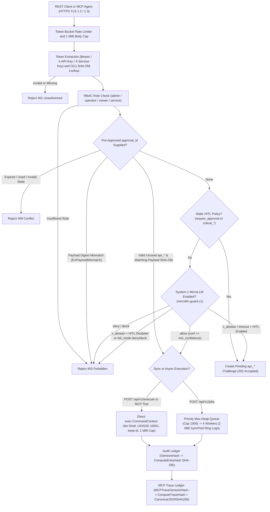

# Zero-Trust MCP Bastion Topology

**API Executor (`go-admin-tool`)** operates as a security-enforcing bastion placed between autonomous AI agents, automation scripts, and privileged Linux host primitives. Rather than granting agents an unconstrained shell or direct host SSH access, every HTTP REST call and Model Context Protocol (MCP JSON-RPC `2.0`) request traverses an ordered pipeline of identity validation, authorization, deterministic and semantic gating, bounded execution, and tamper-evident cryptographic logging.

---

## End-to-End Defense-in-Depth Flow

---

## Architectural Layers and Trust Boundaries

### 1. Transport, Rate Bounding, and O(1) Authentication

Inbound traffic terminates over HTTPS configured with TLS `1.2` minimum by default (`server.tls.min_version: "1.3"` in the hardened `cis-benchmarks` profile), optional mutual TLS (`client_ca_file`), and tight HTTP server socket timeouts (`ReadHeaderTimeout: 5s`, `ReadTimeout: 15s`, `WriteTimeout: 30s`, `IdleTimeout: 60s`). Before parsing bodies, middleware caps payload size at `MaxRequestBodyBytes` (`1 MiB`) and enforces a per-IP token bucket (`requests_per_second: 500`, `burst: 2000`) inside a bounded tracking table (`MaxTrackedRateLimitIPs = 10000` with `2m` stale eviction).

Credential verification hashes bearer tokens (`gat_pat_*`) and service account keys (`gat_svc_*`) with SHA-256 to perform constant-time O(1) index lookups (`tokenByHash`, `serviceAccountByHash`) instead of running slow per-request key-derivation loops on every API call. Username/password logins at `POST /api/v1/auth/login` still execute full `10000`-round salted SHA-256 verification.

### 2. Pre-Approved `approval_id`, Static HITL, and System-1 `MicroLLM` Evaluation

Authorization distinguishes **pre-approved execution tokens** from **unreviewed actions**:

1. **Pre-approved `approval_id` binding**: When a caller resubmits a request carrying an `apr_*` token approved by a distinct administrator (`require_distinct_approver: true`), `approval.Store` computes `ComputePayloadSHA256` over the canonical request target and consumes the token atomically once. Tampered arguments fail verification with `403 Forbidden` (`ErrPayloadMismatch`), whereas expired, already-consumed, or invalidly transitioned tokens return `409 Conflict`, preventing time-of-check to time-of-use (TOCTOU) argument substitution.
2. **Static HITL rules**: Commands marked `require_approval: true` or listed under `approval.critical_commands`, `approval.critical_plugins`, or `approval.critical_mcp_tools` bypass speculative heuristics and mint a pending `apr_*` token (`max_pending: 500`), returning `202 Accepted` (`status: "pending_approval"`).
3. **System-1 `MicroLLM` guard (`microllm.guard.v1`)**: Remaining invocations are evaluated within a sub-millisecond/low-millisecond latency budget (`timeout: "5ms"` default) over loopback HTTP or CLI subprocess (`0` allow, `1` error, `2` deny/block, `3` abstain/escalate). Uncertain verdicts (`x_abstain` or confidence `< 0.70`) and transport errors obey `fail_mode` (`escalate_hitl` by default, returning `202 Accepted` when HITL is enabled or failing closed with `403 Forbidden` if HITL is disabled, or hard `deny`/`block`)—the bastion never fails open.

### 3. Rootless Non-Shell Execution Sandbox (`UID/GID 10001`)

Execution rejects shell interpreters by design: binaries and argument vectors pass directly to `exec.CommandContext` without spawning `/bin/sh -c`. Sandbox configuration enforces `enforce_non_root: true`, `uid: 10001`, `gid: 10001`, `userns: "keep-id"`, `no_new_privileges: true`, and `drop_caps: true`, rejecting `UID/GID 0` or `userns: "host"` during validation. Output stays strictly memory-bounded (`1 MiB` for synchronous `execute_command`, `2 MiB` pooled ring buffers for asynchronous `jobs`).

### 4. Dual Cryptographic Provenance (`audit` + `mcp/traces`)

Every administrative decision and execution emits two linked tamper-evident ledgers:

- The **Audit Ledger** links sequential `EventID` records from `GenesisHash` via `ComputeEntryHash`, writing optional append-only JSONL files with `0600` permissions.
- The **MCP Trace Ledger** links sequential MCP tool calls from `MCPTraceGenesisHash` via `ComputeTraceHash`, storing canonical `CanonicalJSONSHA256` request/response payload digests alongside the correlated `AuditEventID`, `AuditEntryHash`, and `MicroLLM` decision metadata (`decision`, `risk_score`, `latency_ms`).

---

## Related Documentation

- **Configuration Schema & Sandbox Defaults**: [`config-schema-and-profiles.md`](../../03-reference/configuration/config-schema-and-profiles.md)
- **REST & MCP Endpoint Catalog**: [`rest-mcp-endpoints-and-env.md`](../../03-reference/api-and-cli/rest-mcp-endpoints-and-env.md)
- **Error & Alert Matrix**: [`error-and-alert-matrix.md`](../../03-reference/troubleshooting-codes/error-and-alert-matrix.md)
- **HITL & MicroLLM Configuration Guide**: [`configure-hitl-and-microllm-gatekeeper.md`](../../02-how-to-guides/operations/configure-hitl-and-microllm-gatekeeper.md)
- **Audit / MCP Tamper Incident Runbook**: [`remediate-audit-or-mcp-trace-tamper.md`](../../02-how-to-guides/incident-response/remediate-audit-or-mcp-trace-tamper.md)
