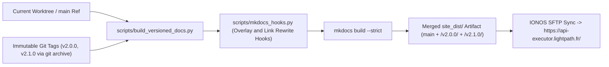

# ADR-002: Diátaxis Documentation Architecture and Versioned MkDocs Publishing

- **Status**: Accepted
- **Scope**: `docs/`, `mkdocs.yml`, `scripts/build_versioned_docs.py`, `scripts/mkdocs_hooks.py`, GitHub Actions CD
- **Target Portal**: `https://api-executor.lightpath.fr/`

---

## Context

As **API Executor (`go-admin-tool`)** grew from initial command execution in `v2.0.0` to async priority jobs, HITL approvals, `MicroLLM` gating, and SHA-256 MCP trace chains in `v2.2.0`, documentation accumulated across root files (`README.md`, `SECURITY.md`, `PROJECT.md`), governance registers (`ACTION_LOGBOOK.md`, `RCA_REGISTER.md`), technical articles, and release notes. Mixing onboarding walkthroughs, dense configuration tables, incident commands, and design rationale on shared pages created navigation friction and obscured version differences between released tags (`v2.0.0`, `v2.1.0`) and `main`.

---

## Decision Drivers

- Separate learning, doing, looking up, and understanding into non-overlapping Diátaxis quadrants.
- Enforce unambiguous procedural French/English runbook clarity (`ASD-STE100 Issue 9`) for on-call incident recovery (`02-how-to-guides/`).
- Publish a static, searchable, multi-version MkDocs Material site including historical releases (`v2.0.0`, `v2.1.0`) without rewriting tagged Git history, deployed atomically over IONOS SFTP.

---

## Decision Outcome

1. **Strict Diátaxis Four-Quadrant Tree**:
   - `docs/01-tutorials/`: Reproducible local onboarding labs (`01-local-https-quickstart.md`, `02-plugins-and-mcp-sandbox.md`, `03-zero-trust-bastion-and-async-jobs-lab.md`).
   - `docs/02-how-to-guides/`: Action-oriented operational and incident runbooks authored to `ASD-STE100 Issue 9` checks.
   - `docs/03-reference/`: Exhaustive schema tables, HTTP/MCP catalogs, environment variables, and error/alert matrices without tutorial prose.
   - `docs/04-explanation/`: Topology diagrams, ADRs, and concurrency/cryptographic analyses without procedural runbook headings.
2. **Immutable Release Tag Overlays (`git archive` + `scripts/mkdocs_hooks.py`)**: `scripts/build_versioned_docs.py` compiles the active `WORKTREE` or `main` ref as the root site, exports tagged snapshots (`v2.0.0`, `v2.1.0`) via `git archive` into isolated build directories, and uses `scripts/mkdocs_hooks.py` to overlay shared Diátaxis navigation assets, rewrite relative repository root links safely, and preserve immutable tag content verbatim.
3. **Strict Link Validation & IONOS SFTP Deployment**: CI builds validate relative links (`mkdocs build --strict` and Diátaxis/STE validators) before synchronizing `site_dist/` to `https://api-executor.lightpath.fr/` over SFTP.

---

## Options and Trade-Offs

| Decision Area | Chosen Option | Rejected Alternative | Trade-Off & Rationale |
| :--- | :--- | :--- | :--- |
| **Doc Organization** | Four isolated Diátaxis quadrants cross-linked across concerns | Monolithic README + topic folders | Prevents runbooks from bloating with architecture essays; requires strict CI checks (`diataxis_check.py`) to maintain quadrant boundaries. |
| **Procedural Style** | `ASD-STE100 Issue 9` for `02-how-to-guides/` | Unconstrained prose runbooks | Limits stylistic variety in runbooks, yet maximizes scanning speed and unambiguous imperative steps during high-stress incidents. |
| **Multi-Version History** | `git archive` tag extraction + `mkdocs_hooks.py` overlays | `mike` branch commits (`gh-pages`) or editing historical tags | Avoids polluting Git history with built HTML branches (`gh-pages`) and never alters signed release tags; requires hook logic for legacy tags lacking `docs/01..04/` directories (`APP-023`). |
| **Hosting Transport** | Static `site_dist/` synced via SFTP to `https://api-executor.lightpath.fr/` | Self-hosted dynamic docs server or GitHub Pages only | Zero runtime attack surface on production docs hosting with LightPath custom domain continuity; requires SFTP credentials scoped in CI secrets. |

---

## Consequences

- **Positive**: Operators jump straight from alert matrices (`03-reference/`) to imperative `ASD-STE100` recovery steps (`02-how-to-guides/`), while auditors can inspect exact `v2.0.0` and `v2.1.0` documentation side-by-side with `main`.
- **Constraints**: Relative links from files inside `docs/` targeting source files outside `docs/` (such as `internal/` or `scripts/`) are rewritten or validated by `scripts/mkdocs_hooks.py` during static builds; living governance logs (`docs/ACTION_LOGBOOK.md`) must never contain broken Markdown relative links to non-existent paths (`RCA-055`).

---

## Related Documentation

- **Docs CLI Flags & Environment Variables**: [`rest-mcp-endpoints-and-env.md`](../../03-reference/api-and-cli/rest-mcp-endpoints-and-env.md)
- **Rootless Deployment & TLS Guide**: [`deploy-rootless-docker-and-tls.md`](../../02-how-to-guides/deployment/deploy-rootless-docker-and-tls.md)
- **Async Jobs & Presets Guide**: [`manage-async-jobs-and-presets.md`](../../02-how-to-guides/operations/manage-async-jobs-and-presets.md)
- **RCA-055 & APP-023 Governance Records**: [`RCA_REGISTER.md`](../../RCA_REGISTER.md)
