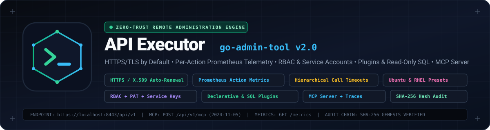

  

# API Executor — Zero-Trust Remote Command & MCP Bastion Platform

API Executor (`go-admin-tool` v2.2.0) is a zero-trust Go remote command executor, async priority job engine, 305+
plugins catalog, and Model Context Protocol (MCP) bastion with Human-in-the-Loop (HITL) approvals and System-1
`MicroLLM` gating. Published documentation lives at
[https://api-executor.lightpath.fr/](https://api-executor.lightpath.fr/).

  

    Go 1.24
    Pure-Go Fallback · CGO_ENABLED=0 Static Binary
  

  

    305+ Plugins
    Across 10 Domains · 24 Native + 281+ Declarative
  

  

    49 HTTP Routes
    TLS 1.3 Default · ECDSA P-256 + Live Cert Rotation
  

  

    Zero-Trust Bastion
    HITL + MicroLLM + SHA-256 Audit &amp; MCP Chains
  

[Start Tutorials](01-tutorials/index.md){ .md-button .md-button--primary }
[Browse How-To Guides](02-how-to-guides/index.md){ .md-button }
[Inspect Reference](03-reference/index.md){ .md-button }
[Read Explanation](04-explanation/index.md){ .md-button }

---

## Diátaxis Documentation Matrix (Action × Cognition)

API Executor organizes its documentation across the four Diátaxis quadrants so every page serves one clear purpose
without mixing hands-on labs, operational runbooks, reference tables, and architectural explanations:

| | **Practical (Action)** | **Theoretical (Cognition)** |
| :--- | :--- | :--- |
| **Acquisition (Study)** | [**1. Tutorials (`01-tutorials/`)**](01-tutorials/index.md) Guided isolated sandbox labs for HTTPS, plugins, MCP, HITL, and async jobs | [**4. Explanation (`04-explanation/`)**](04-explanation/index.md) Zero-Trust MCP bastion topology, cryptographic hash chains, and ADRs |
| **Application (Work)** | [**2. How-To Guides (`02-how-to-guides/`)**](02-how-to-guides/index.md) Goal-oriented ASD-STE100 Issue 9 deployment, bastion, incident, and key-rotation SOPs | [**3. Reference (`03-reference/`)**](03-reference/index.md) Exhaustive YAML configuration schema, 49 HTTP/REST and MCP endpoints, and alert matrices |

---

## Explore Documentation by Quadrant

-   :material-school-outline:{ .lg .middle } **1. Tutorials (`01-tutorials/`)**

    ---

    *Practical · Study / Acquisition* — Follow reproducible local sandboxes covering auto-generated TLS, Personal Access
    Tokens, 305+ plugins, read-only SQLite exposure, JSON-RPC 2.0 MCP traces, HITL approvals, and async jobs.

    - [Tutorials Quadrant Index](01-tutorials/index.md)
    - [Tutorial 1: Local HTTPS Quickstart](01-tutorials/01-local-https-quickstart.md)
    - [Tutorial 2: Plugins & MCP Sandbox](01-tutorials/02-plugins-and-mcp-sandbox.md)
    - [Tutorial 3: Zero-Trust Bastion & Async Jobs Lab](01-tutorials/03-zero-trust-bastion-and-async-jobs-lab.md)

-   :material-wrench-outline:{ .lg .middle } **2. How-To Guides (`02-how-to-guides/`)**

    ---

    *Practical · Work / Application* — Execute ASD-STE100 Issue 9 procedures for rootless UID `10001` Docker deployment,
    async job and OS preset management, HITL + `MicroLLM` gating, tamper remediation, and key rotation.

    - [How-To Guides Quadrant Index](02-how-to-guides/index.md)
    - [Deploy Rootless Docker and TLS](02-how-to-guides/deployment/deploy-rootless-docker-and-tls.md)
    - [Manage Async Jobs and Presets](02-how-to-guides/operations/manage-async-jobs-and-presets.md)
    - [Configure HITL and MicroLLM Gatekeeper](02-how-to-guides/operations/configure-hitl-and-microllm-gatekeeper.md)
    - [Remediate Audit or MCP Trace Tamper](02-how-to-guides/incident-response/remediate-audit-or-mcp-trace-tamper.md)
    - [Rotate TLS and Service Account Keys](02-how-to-guides/security/rotate-tls-and-service-account-keys.md)

-   :material-table-search:{ .lg .middle } **3. Reference (`03-reference/`)**

    ---

    *Theoretical · Work / Application* — Look up exhaustive YAML schema blocks, configuration profiles (`ubuntu`,
    `redhat`, `cis-benchmarks`), 49 REST and MCP endpoints, environment variables, Prometheus metrics, and alert codes.

    - [Reference Quadrant Index](03-reference/index.md)
    - [Configuration Schema & Profiles](03-reference/configuration/config-schema-and-profiles.md)
    - [REST, MCP Endpoints & Environment](03-reference/api-and-cli/rest-mcp-endpoints-and-env.md)
    - [Error & Alert Matrix](03-reference/troubleshooting-codes/error-and-alert-matrix.md)
    - [API Security Audit (`SECURITY.md`)](../SECURITY.md)
    - [Project Architecture Contracts (`PROJECT.md`)](../PROJECT.md)

-   :material-lightbulb-outline:{ .lg .middle } **4. Explanation (`04-explanation/`)**

    ---

    *Theoretical · Study / Acquisition* — Understand the Zero-Trust MCP Bastion topology, 4-tier timeout resolution,
    `sync.Pool` log buffering, SHA-256 hash-chain invariants, and Architecture Decision Records.

    - [Explanation Quadrant Index](04-explanation/index.md)
    - [Zero-Trust MCP Bastion Topology](04-explanation/architecture-overview/zero-trust-mcp-bastion-topology.md)
    - [ADR-001: Zero-Trust Execution & Bastion](04-explanation/design-decisions/adr-001-zero-trust-execution-and-bastion.md)
    - [ADR-002: Diátaxis Versioned MkDocs Publishing](04-explanation/design-decisions/adr-002-diataxis-versioned-mkdocs-publishing.md)
    - [Concurrency, Timeouts & Cryptographic Chains](04-explanation/deep-dives/concurrency-timeouts-and-cryptographic-chains.md)
    - [Security & Architecture Analysis](SECURITY_AND_ARCHITECTURE_ANALYSIS.md)
    - [Project Overview (`README.md`)](../README.md)

-   :material-history:{ .lg .middle } **Releases & Governance**

    ---

    Track versioned releases, living engineering traceability logs, root-cause analyses, and the live versioned
    portal at [api-executor.lightpath.fr](https://api-executor.lightpath.fr/).

    - [Release Notes `v2.1.0`](releases/v2.1.0.md)
    - [Release Notes `v2.0.0`](release_notes_v2.0.0.md)
    - [Action Logbook (`ACTION_LOGBOOK.md`)](ACTION_LOGBOOK.md)
    - [RCA Register (`RCA_REGISTER.md`)](RCA_REGISTER.md)
    - [Published Portal (`api-executor.lightpath.fr`)](https://api-executor.lightpath.fr/)

